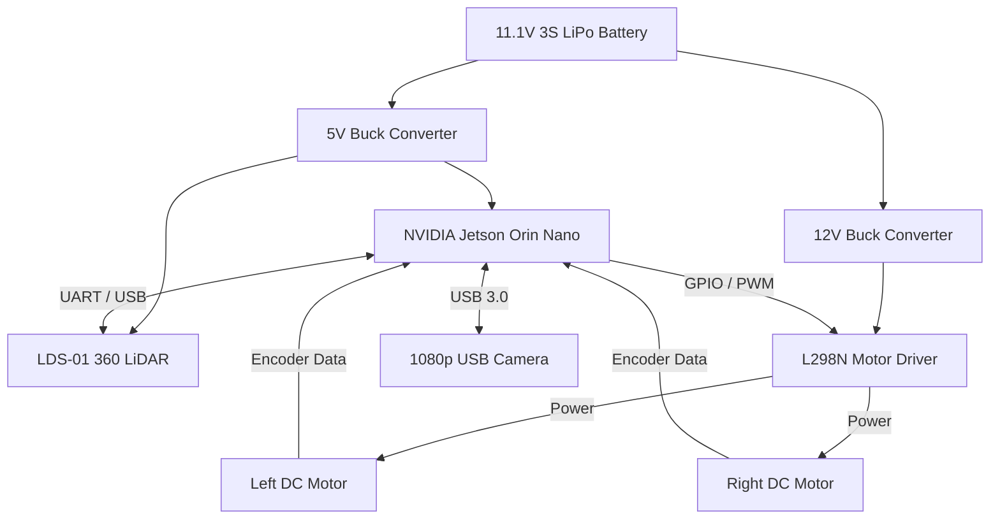
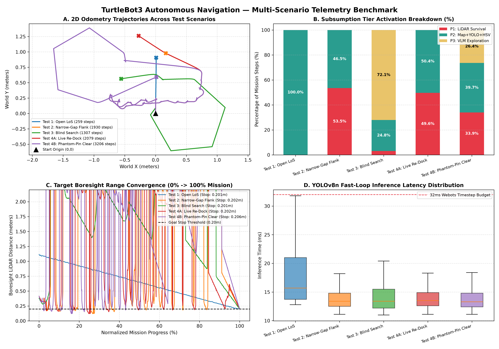
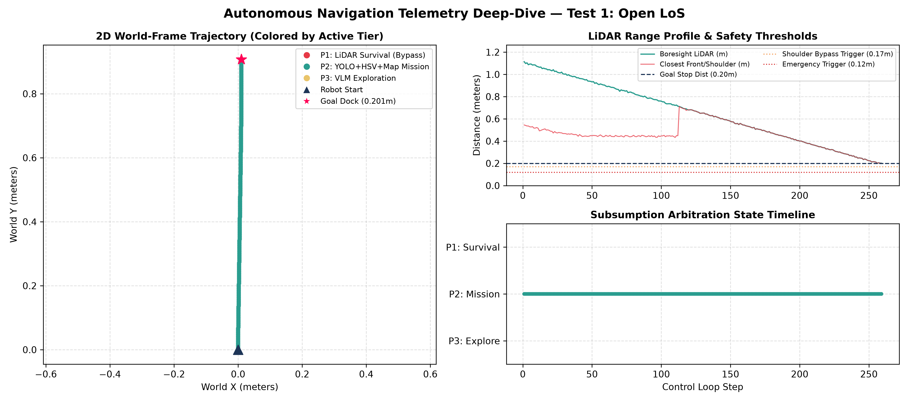
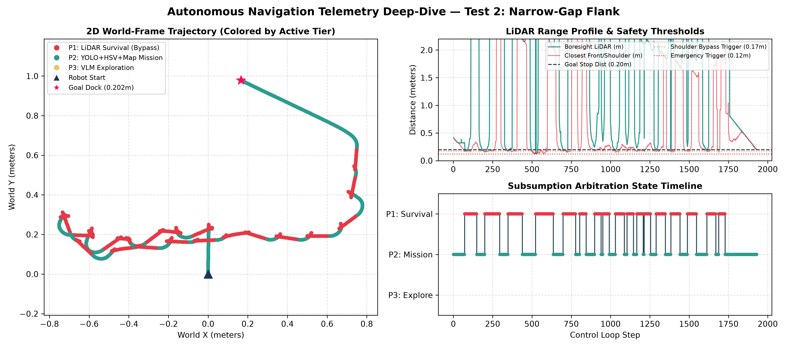
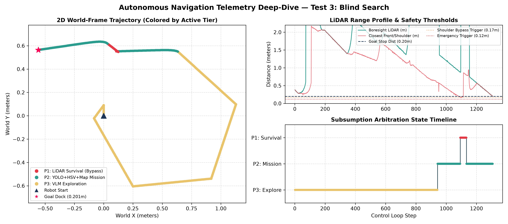
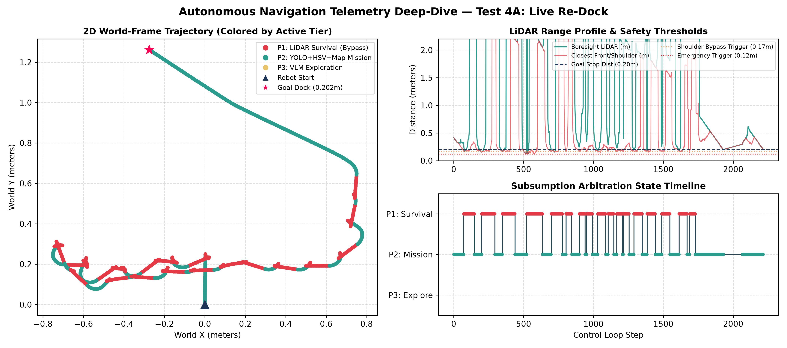
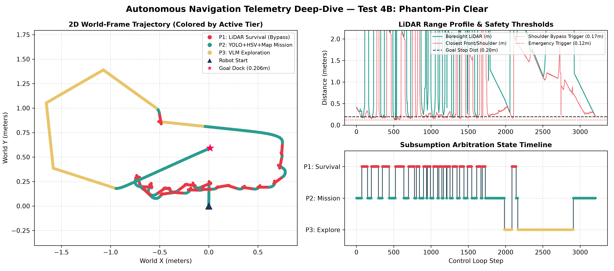

# 🤖 Autonomous VLM-Guided Navigation Brain

An infrastructure-free, plug-and-play autonomous navigation controller for mobile robots. Simulated on a TurtleBot3 Burger within Webots and architected for edge-AI deployment, this system fuses 360° LiDAR mapping with a Dual-AI Vision Stack (YOLOv8 + Moondream VLM) to intelligently explore unmapped environments, evade complex obstacles, and visually hunt down targets without human intervention or pre-programmed routes.

---

## 📂 Repository Architecture & Documentation

To satisfy all hardware and simulation evaluation criteria, this repository is structured as follows:

- 📄 **[Hardware Specifications & Circuit Diagrams](docs/hardware_specifications.md):** Full breakdown and comparison of the simulated TurtleBot3 chassis vs. the proposed physical NVIDIA Jetson Orin Nano build, including power distribution schematics and GPIO pinout tables.
- 🛠️ **[Physical Implementation & Simulation Limitations](docs/physical_implementation.md):** Component functionality, Simulation-to-Reality API migration plan, and real-world physics mitigation strategies.
- 🧠 **`controller.py` / `my_controller.py`:** Core Python autonomous navigation script implementing a Three-Tier Subsumption Architecture and asynchronous VLM daemon thread.
- 📈 **`plot_telemetry.py`:** Automated telemetry analysis and benchmark plotting script.
- 🎯 **`yolov8n.pt`:** Pre-trained YOLOv8 Nano weights bundled for immediate local inference.
- 🌍 **`simulation/Take4.wbt`:** Webots testing arena featuring the TurtleBot3 Burger, 360° LiDAR, RGB Camera, obstacle boxes, and target fire hydrant.
- 📊 **`data/`:** Raw telemetry CSV logs (`mission_telemetry.csv`) and deep-dive evaluation plots across various test scenarios.

---

## 🚀 Key Features

- **Three-Tier Subsumption Architecture:** Seamlessly arbitrates between Priority 1 (Collision Survival & Evasion), Priority 2 (Mission Targeting & Visual Servoing), and Priority 3 (VLM Context-Aware Exploration).
- **Dual-AI Vision Stack:** Combines high-speed bounding-box tracking (YOLOv8n) with an asynchronous local Vision-Language Model (Moondream) for semantic scene understanding and target verification.
- **Real-Time 2D Occupancy Grid Mapping:** Raycasts 360-degree LiDAR data to build a dynamic spatial memory, enabling the robot to navigate around obstacles and remember target pins out of frame.
- **Dynamic Obstacle Evasion:** Features a strict 3-stage box bypass maneuver to smoothly navigate around tight corners and narrow gaps.
- **"Kidnapped Target" Tracking:** Utilizes short-term object permanence and phantom-pin invalidation to dynamically track objects that are moved mid-mission.
- **Close-Range HSV Fallback:** Secondary visual verification system to maintain target locks when physical proximity causes AI bounding-box failures.

---

## ⚙️ Simulation Setup & Instructions to Run/Test

### 1. Prerequisites
Ensure you have the following installed on your system:
- **[Webots](https://cyberbotics.com/)** (R2023b to R2025a supported)
- **[Python 3.8+](https://www.python.org/)**
- **[Ollama](https://ollama.com/)** (running locally for VLM inference)

### 2. Installation
Clone the repository and install the required Python dependencies:
```bash
git clone [https://github.com/yusufkhan210807-wq/autonomous-navigation-brain.git](https://github.com/yusufkhan210807-wq/autonomous-navigation-brain.git)
cd autonomous-navigation-brain
pip install -r requirements.txt
```

Start the local Vision-Language Model via Ollama (ensure the Ollama service is running in the background):
```bash
ollama run moondream
```

### 3. Running the Simulation in Webots
1. Launch **Webots** and open the world file via **File > Open World...** $\rightarrow$ select **`simulation/Take4.wbt`**.
2. In the Webots Scene Tree (top-left panel), expand the **`TurtleBot3Burger`** node.
3. Verify the `controller` field is set to **`my_controller`** (or click **Select...** and point it to `controller.py`).
4. Press the **Play (Run)** button on the top toolbar to start the simulation.
5. **Live Dashboard & Output:**
   * An OpenCV dual-panel window will launch automatically, showing the live RGB camera feed with YOLO/VLM telemetry overlays on the top panel and the real-time 2D LiDAR occupancy grid on the bottom panel.
   * When the robot docks with the target (or when the simulation stops), execution logs are saved to `mission_telemetry.csv` in the project directory.
   * To regenerate the benchmark comparison charts from the CSV logs, run:
     ```bash
     python plot_telemetry.py
     ```

---

## 🔧 Hardware Specifications & Circuit Architecture

### 💻 Compute & Processing
- **NVIDIA Jetson Orin Nano (8GB):** Primary edge AI compute node. Selected for its Tensor Cores, enabling local execution of YOLOv8 and the Moondream VLM without cloud latency.
- **Arduino Mega 2560 (Optional/Sub-controller):** Handles low-level real-time tasks like motor encoder reading and PWM signal generation.

### 👁️ Sensors
- **LDS-01 360-degree 2D LiDAR:** Raycasts the surrounding environment to generate the real-time 2D occupancy grid for Priority 1 obstacle evasion.
- **1080p Wide-Angle USB Camera (FOV 120°):** Captures RGB visual data for the YOLOv8 object detection and Moondream scene classification models.

### ⚙️ Actuation & Power
- **L298N Motor Driver Dual H-Bridge:** Controls the voltage and direction of the two drive wheels.
- **12V DC Gear Motors (x2) with Hall Effect Encoders:** Provides physical locomotion and odometry feedback.
- **11.1V 3S LiPo Battery (5200mAh):** Primary power source.
- **LM2596 Step-Down Buck Converters (x2):** Regulates the 11.1V battery down to 5V (for the Jetson/Sensors) and 12V (for the Motor Driver).

### 🔌 System Architecture & Circuit Diagram



---

## 📊 Experimental Benchmarks & Telemetry Results

All raw telemetry CSV logs and analysis plots (generated via `plot_telemetry.py`) are located in the [`data/`](data/) directory:
- **Test 1 (`test1_open_los.csv`):** Open Line-of-Sight Target Acquisition
- **Test 2 (`test2_occlusion.csv`):** Obstacle Occlusion & 3-Stage Box Bypass
- **Test 3 (`test3_blind_search.csv`):** Unmapped Arena VLM-Guided Blind Search
- **Test 4A (`test4a_redock.csv`):** Target Relocation / Re-docking Recovery
- **Test 4B (`test4b_midroute.csv`):** Dynamic "Kidnapped Target" Mid-Route Tracking

### Overall Telemetry Comparison Dashboard


### Individual Mission Deep Dives

| Test 1: Open LOS | Test 2: Occlusion Evasion |
| :---: | :---: |
|  |  |

| Test 3: Blind Search | Test 4A: Re-docking | Test 4B: Mid-Route Kidnapped Target |
| :---: | :---: | :---: |
|  |  |  |
